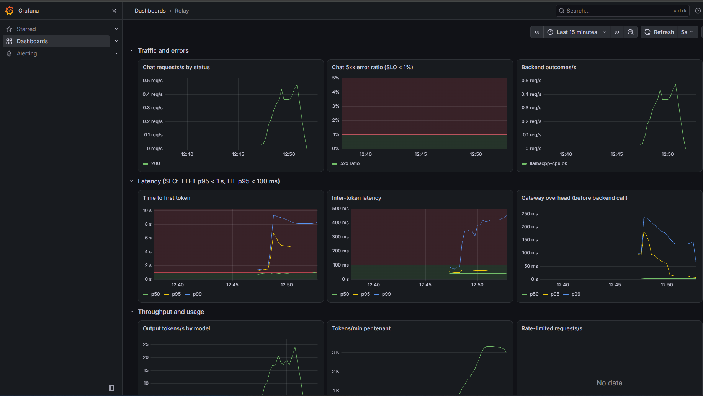

# Relay

**A self-hosted, OpenAI-compatible LLM gateway, and a benchmark that measures which serving setup meets a latency target at the lowest cost.**

[](https://github.com/sanskar800/relay-llm-gateway/actions/workflows/ci.yml)

Relay sits between applications and self-hosted open-weight models (llama.cpp, vLLM). It speaks the standard OpenAI `/v1/chat/completions` API, so any OpenAI SDK client works unchanged, and adds what an organisation needs to share a model fleet: API keys per team, model policies, rate limits, a usage and cost ledger, and the reliability and observability to run it.

The **benchmark harness** then answers the sizing question with measurements rather than vendor claims: *on this GPU, which model and quantisation serve the most users within the latency target, at what cost per token, and how good are the answers?*

> In production you would probably use an existing gateway such as [LiteLLM](https://github.com/BerriAI/litellm) or Envoy AI Gateway. I built Relay to understand and measure what such a gateway does: streaming correctness, rate-limit semantics, failure behaviour and its own overhead.

## Benchmark results

<!-- results:start (generated by `make report` from results/; do not edit) -->
Measured through Relay on a free Colab **Tesla T4** with **vLLM 0.31.0**, open-loop Poisson load; SLO: TTFT p95 < 1 s, ITL p95 < 100 ms, errors < 1%. The capacity lies between the two rates shown.

| Configuration | Meets SLO up to | Misses from | Output tok/s at the limit | Est. GBP / 1M output tokens | GSM8K accuracy |
|---|---|---|---|---|---|
| 1.5B AWQ 4-bit | 6.36 req/s | 8.18 req/s | 676 | 0.19 | 65.5% |
| 1.5B FP16 | 5.14 req/s | 7.17 req/s | 537 | 0.24 | 72.0% |
| 7B AWQ 4-bit | 0.84 req/s | 1.43 req/s | 91 | 1.41 | 95.0% |

Cost is an estimate: measured throughput x an assumed public T4 list price (`bench/pricing.yaml`). GSM8K: the same 200 questions, zero-shot; see the report for intervals and significance.

**Gateway overhead:** Relay adds 3.7-4.1 ms at p50 and at most 9.3 ms at p95 before the first token (2 runs on the dev laptop against a fixed-latency fake engine; findings F2).


<!-- results:end -->

Full report, with every load level, method and limitations: **[docs/report.md](docs/report.md)**. It is generated from the raw per-request Parquet files by `make report` and regenerates byte for byte.

**What the results show** (details and evidence in the report and in [docs/findings.md](docs/findings.md)):

- **4-bit AWQ is much faster than FP16 for one user, but its lead shrinks under load.** A single stream is limited by memory bandwidth (reading the weights), where 4-bit helps most; large batches make the GPU compute-bound.
- **Model size matters far more than quantisation.** The 7B model answers far more maths questions correctly, at several times the cost per token. Quantising the 1.5B model costs a little accuracy, but the difference is not statistically significant on 200 questions.
- **Past saturation, latency explodes.** An open-loop load test keeps sending at the offered rate and shows the queue growing; a closed loop would have hidden it.

## The Grafana dashboard



*The provisioned dashboard during a few minutes of demo traffic against llama.cpp on the development laptop's CPU (not a benchmark: the gateway and the engine shared one busy CPU). As load passes what the CPU can serve, requests queue and time to first token crosses its 1 s SLO line while errors stay at zero. The panels track the brief's SLOs: TTFT and inter-token latency p95, the 5xx error ratio, gateway overhead, tokens per tenant and rate-limited requests.*

## How the numbers were made trustworthy

Getting a benchmark right took more work than running it. Each of these was found during the build, fixed, and is recorded in [docs/findings.md](docs/findings.md):

- **No prompt is ever sent twice.** Engines cache prompt prefixes across requests; an early run reused seeded prompts and showed time-to-first-token many times faster than reality. Prompt openings are now salted per run and level.
- **The measuring tool was validated first,** against a fake engine that records when it really sent each token. The scripted delays were not trusted: on Windows, sleeps overshoot.
- **Every run is checked automatically** and set aside if it was served by the wrong backend, if the host ran short of memory, or if the client fell behind. One full run was rejected this way.
- **Every reported number is recomputed in SQL** (DuckDB) from raw timestamps and must match the harness's own Python to within 1e-9; a test enforces it.
- **A saturation probe that suited one engine misled on another**, so the first runs gave only lower bounds; the probe was widened and the runs repeated, and two sessions on different machines agreed.

## What Relay does

| Area | What is built |
|---|---|
| **API** | OpenAI-compatible `/v1/chat/completions` (streaming and non-streaming) and `/v1/models`; OpenAI-format errors; verified with the official OpenAI SDK in contract tests |
| **Tenancy and governance** | API keys stored as SHA-256 hashes; tenants with model allow-lists and `max_tokens` caps; request size limits |
| **Rate limiting** | Redis token buckets (requests and tokens per minute) in an atomic Lua script; if Redis is down, the same limits are enforced locally ([ADR-002](docs/adr/002-rate-limit-failure-behaviour.md)) |
| **Usage and cost** | Every request's tokens and estimated cost in a PostgreSQL ledger, written in batches off the request path; `relay-admin usage` report |
| **Reliability** | Per-backend timeouts (connect, first token, idle, total); retries only before the first streamed token ([ADR-003](docs/adr/003-streaming-retry-policy.md)); circuit breakers with fallback to the next backend; graceful shutdown that drains in-flight streams |
| **Observability** | JSON logs with request and trace IDs; Prometheus metrics (TTFT, inter-token latency, tokens, breaker state); a provisioned Grafana dashboard; SLO alert rules tested with promtool; OpenTelemetry traces in Jaeger |
| **Benchmark harness** | Open-loop Poisson load generator; TTFT, inter-token latency, TPOT, goodput, p50/p95/p99; seeded workloads; results as Parquet with full environment metadata; automatic validity checks; GSM8K answer-quality evaluation with a paired significance test |
| **Deployment** | Docker Compose stack; a standalone mode with no Postgres or Redis for single-user hosts; a Colab notebook that runs the GPU benchmark without code edits |

## Architecture

```text
          Clients (OpenAI SDK, curl)
                    │  Authorization: Bearer <api key>
                    ▼
┌──────────────────────── Relay gateway (FastAPI, async) ────────────────────────┐
│  auth → tenant policy → rate limit (Redis) → routing → reliability             │
│  (timeouts · retries before the first token · circuit breaker · fallback)      │
│  SSE streaming passthrough → token accounting → usage ledger (PostgreSQL)      │
└───────────────┬───────────────────────────────┬────────────────────────────────┘
                ▼                               ▼
     llama.cpp server (GGUF)              vLLM (FP16 / AWQ)
     development and CI (CPU / GPU)       benchmark on a Colab T4

  Metrics → Prometheus → Grafana        Traces → OpenTelemetry → Jaeger
  Benchmark harness → results/*.parquet → DuckDB → docs/report.md + charts
```

The design and the reason for each component are in [docs/architecture.md](docs/architecture.md); the significant decisions are recorded as [ADRs](docs/adr/).

## Quick start (local development)

**Prerequisites:** Docker Desktop, [uv](https://docs.astral.sh/uv/), GNU Make and about 2 GB of disk for models. Ports 8000 (Relay), 8081 (llama.cpp), 5433 (Postgres) and 6379 (Redis) must be free. No GPU needed.

```bash
git clone https://github.com/sanskar800/relay-llm-gateway.git relay
cd relay
cp .env.example .env   # local settings (git-ignored)
make setup     # Python 3.12 venv with the exact dependencies from uv.lock
make models    # pinned Qwen2.5 GGUF models (~1.6 GB) to ~/models, SHA-256 verified
make up        # llama.cpp (:8081), Postgres (:5433), Redis (:6379), Prometheus, Grafana, Jaeger

# Create a tenant and an API key (the key is printed once: keep it)
uv run relay-admin create-tenant demo --models qwen2.5-1.5b-instruct --rpm 60 --tpm 20000
uv run relay-admin create-key demo --name quickstart

make run       # Relay on http://localhost:8000 (leave running; use a second terminal below)
```

Call it with the **official OpenAI SDK**, changing only `base_url` (run with `uv run python`):

```python
from openai import OpenAI

client = OpenAI(base_url="http://localhost:8000/v1", api_key="rk_...")  # your key
reply = client.chat.completions.create(
    model="qwen2.5-1.5b-instruct",
    messages=[{"role": "user", "content": "In one sentence, what is an API gateway?"}],
    max_tokens=60,
)
print(reply.choices[0].message.content, reply.usage)
```

Or with `curl`:

```bash
curl http://localhost:8000/v1/chat/completions -H "Authorization: Bearer rk_..." -H "Content-Type: application/json" \
  -d '{"model": "qwen2.5-1.5b-instruct", "messages": [{"role": "user", "content": "Hello"}], "max_tokens": 30}'
```

Then look around: Swagger UI at http://localhost:8000/docs, Grafana at http://localhost:3001, Prometheus at http://localhost:9090, Jaeger at http://localhost:16686.

```bash
make test              # unit tests (no model or Docker needed)
make test-integration  # tests against Postgres and Redis
make test-contract     # OpenAI SDK contract tests (needs RELAY_TEST_API_KEY in .env)
make down              # stop the stack
```

The full setup guide, including Windows notes, is [docs/development.md](docs/development.md).

## Reproducing the benchmark

- **GPU runs:** open [`bench/colab/relay_benchmark.ipynb`](https://colab.research.google.com/github/sanskar800/relay-llm-gateway/blob/main/bench/colab/relay_benchmark.ipynb) in Colab with a T4 runtime and run it. It installs everything, starts vLLM and Relay, finds each configuration's saturation point, runs the load test and the GSM8K evaluation, and zips the results. No code is edited in Colab.
- **Report:** put the results under `results/` and run `make report`.
- **Local load tests:** `make bench SCENARIO=bench/scenarios/<name>.yaml`; Relay's own overhead: `make bench-overhead`.

## Limitations

- **One GPU class.** All benchmark numbers come from a free Colab Tesla T4 (16 GB). They do not transfer to other GPUs and are not capacity planning for larger hardware.
- **Assumed prices.** Cost per token is measured throughput multiplied by a public on-demand list price (source and date in `bench/pricing.yaml`), not a bill.
- **One inference engine benchmarked.** vLLM was benchmarked; llama.cpp is Relay's development and CI backend but was not, because the laptop proved an unreliable benchmark host ([ADR-001](docs/adr/001-inference-engines-and-hardware.md), amendment).
- **Synthetic prompts and single runs.** Lengths follow documented distributions, content is filler text, and each configuration was run once (cross-checked against an earlier session). Capacity is reported as a range between two tested load levels.
- **No paid services were used**: no rented GPUs and no hosted LLM APIs.

## Repository layout

```text
src/relay/        gateway: api, auth, limits, routing, backends, accounting, telemetry
bench/            load generator, scenarios, quality evaluation, analysis, Colab notebook
results/          benchmark runs (config, Parquet, environment, summary), charts, GSM8K answers
deploy/compose/   Docker Compose stack
monitoring/       Prometheus config and alert rules, Grafana dashboard
tests/            unit, integration and contract tests
docs/             report, findings, architecture, development guide, ADRs
```

## Documentation

- [docs/report.md](docs/report.md): benchmark report (generated)
- [docs/findings.md](docs/findings.md): what the build and the benchmark revealed, with evidence
- [docs/architecture.md](docs/architecture.md): system design and accepted deviations from the original plan
- [docs/adr/](docs/adr/): architecture decision records
- [docs/brief.md](docs/brief.md): requirements brief (tenants, quotas, SLO targets)
- [docs/development.md](docs/development.md): setup, running, testing and benchmarking
