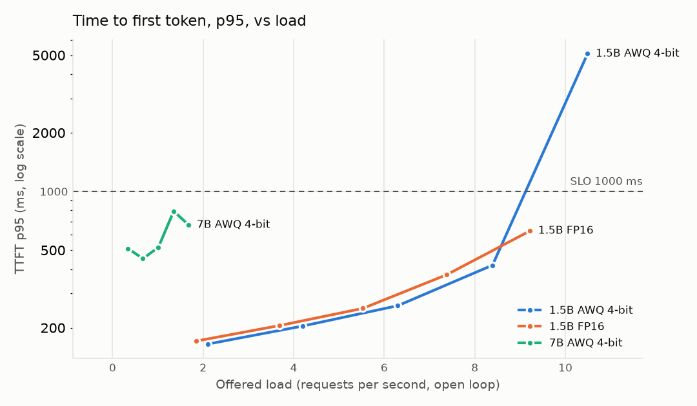
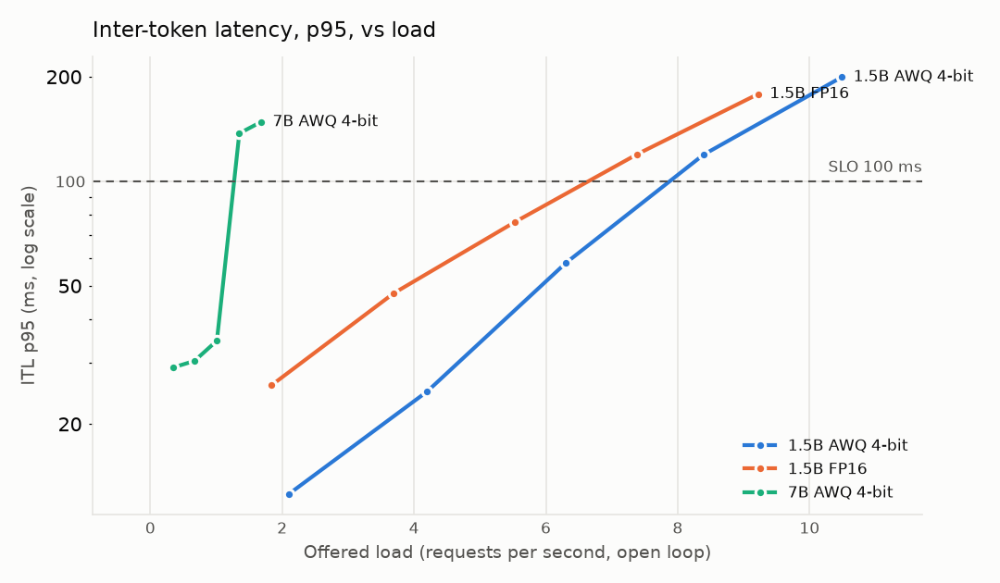
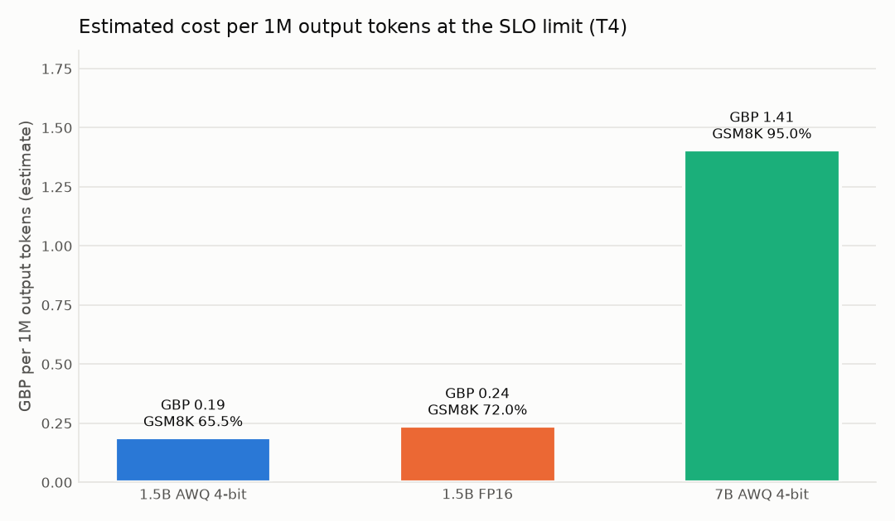
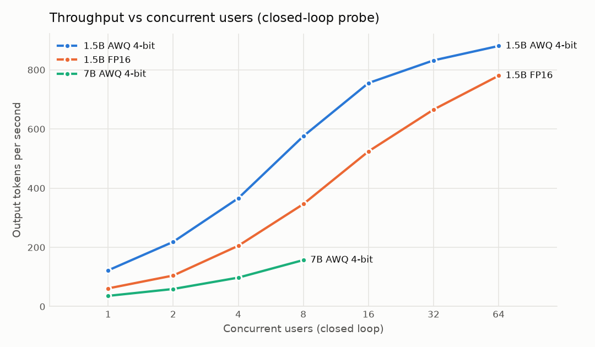
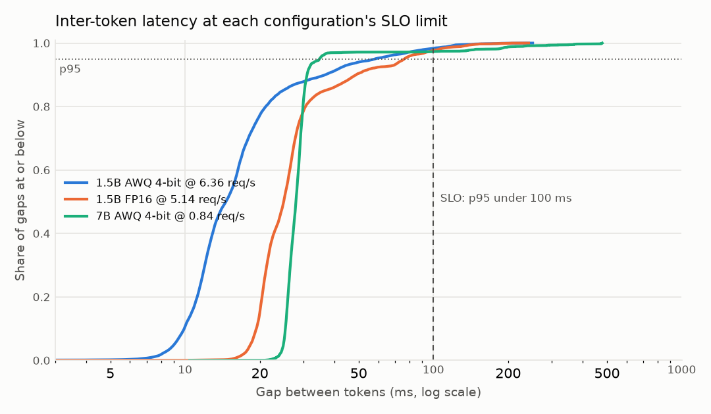

# Relay benchmark report

> **Generated** by `python -m bench.analysis.analyze` (`make report`) from the files in [`results/`](../results/). Do not edit by hand: change the data or the generator and regenerate. Every number below is recomputed in DuckDB from the raw per-request timestamps (`bench/analysis/queries.sql`).

## Headline: the highest load each configuration serves within the SLO

SLO (docs/brief.md): **TTFT p95 < 1 s, ITL p95 < 100 ms, error rate < 1%**, through Relay, open-loop Poisson arrivals. The true limit lies between the last rate that met the SLO and the first that missed it.

| Configuration | Meets SLO up to | Misses from | Output tok/s at the limit | TTFT p95 / ITL p95 there | Est. GBP per 1M output tokens | GSM8K (95% CI) |
|---|---|---|---|---|---|---|
| 1.5B AWQ 4-bit | 6.36 req/s | 8.18 req/s | 676 | 260 ms / 58 ms | 0.19 | 65.5% (58.7%-71.7%) |
| 1.5B FP16 | 5.14 req/s | 7.17 req/s | 537 | 252 ms / 76 ms | 0.24 | 72.0% (65.4%-77.8%) |
| 7B AWQ 4-bit | 0.84 req/s | 1.43 req/s | 91 | 517 ms / 35 ms | 1.41 | 95.0% (91.0%-97.3%) |

Cost is an **estimate: measured throughput x assumed public list price**: a T4 at USD 0.615/h x 0.747 GBP/USD (AWS g4dn.xlarge on-demand, eu-west-2; source and date in `bench/pricing.yaml`), divided by the measured output tokens per second, assuming the GPU is busy all hour.

## What the results show

- **4-bit AWQ is faster than FP16 on the same 1.5B model, most of all for a single stream:** 9.2 vs 18.0 ms per output token at the lightest load (2.0x), but 6.36 vs 5.14 req/s at the SLO limit (1.24x). One stream is limited by memory bandwidth (reading the weights, where 4-bit helps most); large batches make the GPU compute-bound, where AWQ also pays to dequantise.
- **Model size dominates cost:** 7B AWQ meets the SLO up to 0.84 req/s, about 7x the cost per token of 1.5B AWQ; its inter-token latency is what breaks first.
- **Past saturation, queues explode:** the open loop keeps sending at the offered rate, so once a configuration cannot keep up, waiting requests pile up and TTFT climbs by orders of magnitude (see the highest rates in the tables). A closed-loop test would have hidden this, because its clients slow down with the server.

## Answer quality (GSM8K)

The same 200 GSM8K test questions (fixed seed) for every configuration, zero-shot, temperature 0, at most 1024 output tokens, scored by exact final number (`bench/quality/gsm8k.py`). Zero-shot scores compare these configurations with each other; they are not comparable with published few-shot scores.

| Configuration | Correct | Accuracy | 95% Wilson interval | Errors | Truncated |
|---|---|---|---|---|---|
| 1.5B AWQ 4-bit | 131/200 | 65.5% | 58.7%-71.7% | 0 | 0 |
| 1.5B FP16 | 144/200 | 72.0% | 65.4%-77.8% | 0 | 0 |
| 7B AWQ 4-bit | 190/200 | 95.0% | 91.0%-97.3% | 0 | 0 |

Paired comparison on the same questions (exact McNemar test):

- **1.5B FP16 vs 1.5B AWQ 4-bit:** only 1.5B FP16 right on 28 questions, only 1.5B AWQ 4-bit right on 15: p = 0.066 (not significant at 0.05).
- **7B AWQ 4-bit vs 1.5B AWQ 4-bit:** only 7B AWQ 4-bit right on 62 questions, only 1.5B AWQ 4-bit right on 3: p < 0.0001 (significant).

## Per-configuration results

### 1.5B AWQ 4-bit (`colab-t4-1.5b-awq`)

- **Hardware:** Tesla T4 (15360 MiB, driver 580.82.07); NVIDIA Tesla T4 16 GB (Google Colab, free tier)
- **Engine:** vLLM 0.31.0 `--dtype half --max-model-len 2048 --quantization awq`
- **Model:** `Qwen/Qwen2.5-1.5B-Instruct-AWQ@3ecffa0ceb27851800f45519bab9c457a04405e1`
- **Run:** [`run-2026-10-24-colab-t4-1.5b-awq-130532`](../results/run-2026-10-24-colab-t4-1.5b-awq-130532/), code `0c4deb2`; rates from probe `run-2026-10-24-colab-t4-1.5b-awq-probe-125518` (1-64 users)

| Offered (req/s) | Served (req/s) | Errors | TTFT p50 | TTFT p95 | ITL p95 | TPOT p50 | Output tok/s | Goodput | SLO |
|---|---|---|---|---|---|---|---|---|---|
| 2.10 | 2.11 | 0 | 75 ms | 165 ms | 13 ms | 9 ms | 227 | 100% | meets |
| 4.20 | 4.04 | 0 | 96 ms | 204 ms | 25 ms | 12 ms | 428 | 100% | meets |
| 6.30 | 6.36 | 0 | 121 ms | 260 ms | 58 ms | 20 ms | 676 | 100% | meets |
| 8.39 | 8.18 | 0 | 200 ms | 419 ms | 119 ms | 38 ms | 879 | 100% | **misses** |
| 10.49 | 9.37 | 0 | 3195 ms | 5090 ms | 200 ms | 89 ms | 1015 | 6% | **misses** |

### 1.5B FP16 (`colab-t4-1.5b-fp16`)

- **Hardware:** Tesla T4 (15360 MiB, driver 580.82.07); NVIDIA Tesla T4 16 GB (Google Colab, free tier)
- **Engine:** vLLM 0.31.0 `--dtype half --max-model-len 2048`
- **Model:** `Qwen/Qwen2.5-1.5B-Instruct@989aa7980e4cf806f80c7fef2b1adb7bc71aa306`
- **Run:** [`run-2026-10-24-colab-t4-1.5b-fp16-124854`](../results/run-2026-10-24-colab-t4-1.5b-fp16-124854/), code `0c4deb2`; rates from probe `run-2026-10-24-colab-t4-1.5b-fp16-probe-123835` (1-64 users)

| Offered (req/s) | Served (req/s) | Errors | TTFT p50 | TTFT p95 | ITL p95 | TPOT p50 | Output tok/s | Goodput | SLO |
|---|---|---|---|---|---|---|---|---|---|
| 1.84 | 1.74 | 0 | 89 ms | 171 ms | 26 ms | 18 ms | 189 | 100% | meets |
| 3.69 | 3.79 | 0 | 110 ms | 205 ms | 48 ms | 24 ms | 396 | 100% | meets |
| 5.53 | 5.14 | 0 | 134 ms | 252 ms | 76 ms | 30 ms | 537 | 100% | meets |
| 7.38 | 7.17 | 0 | 201 ms | 374 ms | 120 ms | 47 ms | 767 | 100% | **misses** |
| 9.22 | 8.88 | 0 | 319 ms | 628 ms | 178 ms | 76 ms | 958 | 99% | **misses** |

### 7B AWQ 4-bit (`colab-t4-7b-awq`)

- **Hardware:** Tesla T4 (15360 MiB, driver 580.82.07); NVIDIA Tesla T4 16 GB (Google Colab, free tier)
- **Engine:** vLLM 0.31.0 `--dtype half --max-model-len 2048 --quantization awq`
- **Model:** `Qwen/Qwen2.5-7B-Instruct-AWQ@b25037543e9394b818fdfca67ab2a00ecc7dd641`
- **Run:** [`run-2026-10-22-colab-t4-7b-awq-134350`](../results/run-2026-10-22-colab-t4-7b-awq-134350/), code `9b46e84` (recorded `dirty: true`: untracked files only, findings F10); rates from probe `run-2026-10-22-colab-t4-7b-awq-probe-133336` (1-8 users)

| Offered (req/s) | Served (req/s) | Errors | TTFT p50 | TTFT p95 | ITL p95 | TPOT p50 | Output tok/s | Goodput | SLO |
|---|---|---|---|---|---|---|---|---|---|
| 0.34 | 0.33 | 0 | 266 ms | 510 ms | 29 ms | 28 ms | 42 | 100% | meets |
| 0.67 | 0.56 | 0 | 250 ms | 453 ms | 30 ms | 30 ms | 64 | 100% | meets |
| 1.01 | 0.84 | 0 | 247 ms | 517 ms | 35 ms | 32 ms | 91 | 100% | meets |
| 1.35 | 1.43 | 0 | 289 ms | 792 ms | 137 ms | 44 ms | 160 | 99% | **misses** |
| 1.68 | 1.45 | 0 | 313 ms | 674 ms | 148 ms | 48 ms | 159 | 99% | **misses** |

## Method

- **Path:** client -> Relay (standalone: one key, in-memory limits) -> vLLM on the same VM. Relay's own added latency was measured separately (about 4 ms at p50 before the first token on the dev laptop; `docs/findings.md` F2).
- **Load:** open loop, Poisson arrivals at 5 rates from 0.25x to 1.25x of a closed-loop probe's peak (probe range listed per configuration), 120 s per rate after a 20 s warm-up that is excluded.
- **Workload:** identical for every configuration: prompt lengths log-normal (median 200 tokens, 16-600), output lengths log-normal (median 96, 16-256) with `ignore_eos`, seed 42; prompt openings salted per run and level so no prompt is ever resent (prefix caching would flatter TTFT; findings F1).
- **Metrics:** TTFT = first content token - send; ITL = gap between token arrivals; TPOT = (end - first token) / (tokens - 1); percentiles by linear interpolation; rates over the window from the end of warm-up to the last response.
- **Validity checks:** every request served by the expected backend; host RAM never under 1 GiB; requests sent no more than 100 ms late (p99), so the client was never the bottleneck. Runs failing a check are set aside, not reported. The harness checks these automatically (the client-lag check was added after the 7B run); in the reported runs the worst scheduling lag p99 at any level is 14 ms.

## Limitations

- **One GPU class:** a free Colab T4 (Turing, 16 GB). Numbers do not transfer to other GPUs and are not capacity planning for larger hardware.
- **Assumed prices:** cost is measured throughput x a public list price, not a bill.
- **One engine on the GPU:** vLLM 0.31.0. llama.cpp is Relay's development backend but was not benchmarked: the laptop proved an unreliable benchmark host (ADR-001 amendment).
- **Synthetic prompts:** lengths follow documented distributions; content is filler text. Real traffic with shared system prompts would gain from prefix caching.
- **Single runs:** one run per configuration (the 1.5B configurations agreed with an earlier session where rates overlapped, findings F11); the SLO limit is a bracket between two tested rates, not a point.
- **Zero-shot GSM8K on 200 questions:** about +-7 points of uncertainty per configuration.
